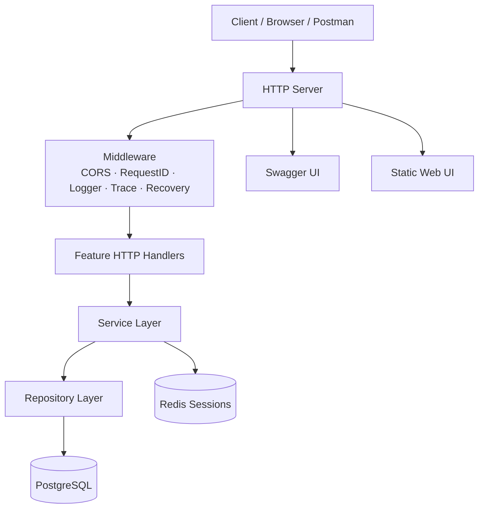
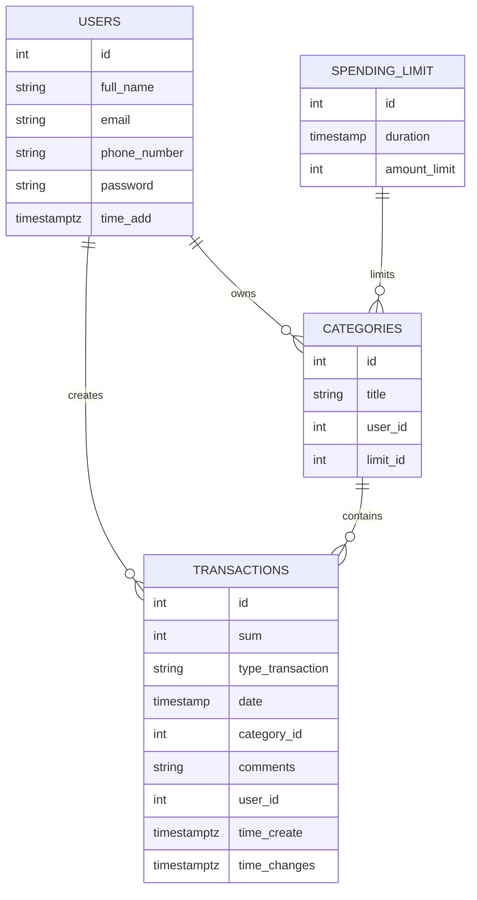

# ExpensesTracker

<p align="center">
  
  
  
  
  
</p>

<p align="center">
  <b>Backend-сервис для учета доходов, расходов, категорий, лимитов и финансовой статистики.</b>
</p>

ExpensesTracker — учебно-практический backend-проект на Go, который имитирует небольшой финансовый сервис: пользователь может создавать категории, добавлять операции доходов/расходов, назначать лимиты и получать статистику по своим тратам.

Проект сделан не как один большой CRUD-файл, а как сервис с разделением по слоям: HTTP transport, service layer, repository layer, PostgreSQL, Redis, middleware, migrations, Swagger-документация, Docker-окружение и GitHub Actions для проверки/деплоя.

---

## Что умеет проект

- Создание, получение, обновление и удаление пользователей.
- Работа с категориями расходов и доходов.
- Создание и фильтрация транзакций.
- Поддержка лимитов расходов для категорий.
- Финансовая статистика по пользователю, категориям и периоду.
- Сессии через Redis.
- Swagger/OpenAPI-документация для API.
- Запуск инфраструктуры через Docker Compose.
- Миграции базы данных через `migrate/migrate`.
- Логирование через `zap`.
- Middleware для CORS, request id, логирования, trace и panic recovery.
- CI/CD-пайплайн через GitHub Actions.

---

## Чем проект интересен

- **Слои приложения разделены**: транспорт, бизнес-логика и доступ к данным не смешаны в одном месте.
- **PostgreSQL используется осознанно**: есть внешние ключи, уникальные ограничения, проверки и миграции.
- **Redis вынесен отдельно** для хранения сессионных данных.
- **Docker Compose поднимает всё окружение**: приложение, PostgreSQL, Redis, миграции, port-forwarder и Swagger tooling.
- **Swagger генерируется из кода**, поэтому API можно смотреть и тестировать через документацию.
- **GitHub Actions проверяет запуск приложения и деплоит на сервер** после успешной проверки.
- **Есть минимальный web-интерфейс**, поэтому проект можно открыть в браузере, а не только дергать через curl/Postman.

---

## Стек

| Категория | Технологии |
|---|---|
| Язык | Go |
| База данных | PostgreSQL |
| Кэш / сессии | Redis |
| API | HTTP REST |
| Документация API | Swagger / OpenAPI |
| Миграции | migrate/migrate |
| Логирование | zap |
| Конфигурация | envconfig + `.env` |
| Контейнеризация | Docker, Docker Compose |
| CI/CD | GitHub Actions |
| Frontend | HTML, CSS, JavaScript |

---

## Архитектура



Код внутри `internal/features` разделен по доменным модулям:

```text
internal/features/
├── users/          # пользователи
├── category/       # категории
├── transaction/    # доходы и расходы
├── limit/          # лимиты расходов
├── static/         # статистика
├── session/        # сессии
└── web/            # отдача web-интерфейса
```

Общие инфраструктурные части лежат отдельно:

```text
internal/core/
├── domain/         # общие доменные структуры
├── errors/         # обработка ошибок
├── logger/         # конфигурация логера
├── repository/     # подключение к PostgreSQL / Redis
└── transport/      # HTTP server, middleware, routing
```

---

## Основные сущности



---

## API

Базовый путь API:

```text
/api/v1
```

Основные группы эндпоинтов:

| Группа | Назначение |
|---|---|
| `/users` | CRUD пользователей |
| `/users/login` | создание пользовательской сессии |
| `/session/{sessionID}` | получение данных сессии |
| `/category` | CRUD категорий |
| `/transactions` | CRUD и фильтрация транзакций |
| `/limit` | CRUD лимитов |
| `/static/{user_id}` | финансовая статистика |

После запуска Swagger UI доступен по адресу:

```text
http://localhost:8080/swagger/index.html
```

---

## Быстрый запуск через Docker Compose

### 1. Клонировать репозиторий

```bash
git clone https://github.com/Hodorev-Evgeny/ExpensesTracker.git
cd ExpensesTracker
```

### 2. Создать `.env`

```bash
cp .env.example .env
```

Пример значений для локального запуска через Docker Compose:

```env
HTTP_ADDR=:8080
HTTP_SHUTDOWN_TIMEOUT=10s
HTTP_ALLOWED_ORIGINS=http://localhost:8080,http://127.0.0.1:8080
HTTP_TIMEZONE=UTC

POSTGRES_USER=postgres
POSTGRES_PASSWORD=postgres
POSTGRES_HOST=data-base
POSTGRES_PORT=5432
POSTGRES_DB=expenses_tracker
POSTGRES_TIMEOUT=5s

REDIS_ADDR=redis-db:6379
REDIS_PASSWORD=redis
REDIS_DATABASE=0

LOGGER_LEVEL=debug
LOGGER_FOLDER=/app

PROJECT_ROOT=.
```

### 3. Запустить приложение

```bash
make tracker-deploy-run
```

Приложение будет доступно по адресу:

```text
http://localhost:8080
```

### 4. Остановить приложение

```bash
make tracker-deploy-stop
```

---

## Запуск для разработки

Поднять PostgreSQL и Redis:

```bash
make env-up
```

Запустить миграции:

```bash
make migrate-up
```

Запустить приложение локально:

```bash
make app-run
```

При локальном запуске через `make app-run` приложение стартует из исходников через `go run`, а данные PostgreSQL и Redis можно держать в Docker.

---

## Миграции

Создать новую миграцию:

```bash
make migrate-create seq=add_some_feature
```

Применить миграции:

```bash
make migrate-up
```

Откатить миграции:

```bash
make migrate-down
```

Сбросить состояние миграций:

```bash
make clean_migrate
```

---

## Swagger

Сгенерировать Swagger-документацию:

```bash
make swagger-generate
```

Документация генерируется в папку `docs` и подключается к приложению при старте сервера.

---

## CI/CD

В репозитории настроен GitHub Actions pipeline, который:

1. Создает `.env` из GitHub Secrets.
2. Собирает и запускает приложение через Docker Compose.
3. Проверяет доступность сервиса по HTTP.
4. Подключается к серверу по SSH.
5. Обновляет код на сервере из ветки `master`.
6. Перезапускает приложение.
7. Проверяет, что задеплоенный сервис отвечает.

---

## Структура проекта

```text
.
├── .github/workflows/        # GitHub Actions pipeline
├── cmd/trackerapp/           # точка входа приложения и Dockerfile
├── docs/                     # Swagger/OpenAPI документация
├── internal/
│   ├── core/                 # общая инфраструктура приложения
│   └── features/             # бизнес-модули
├── migrations/               # SQL-миграции базы данных
├── public/                   # статический web-интерфейс
├── docker-compose.yaml       # локальное и deploy-окружение
├── Makefile                  # команды для запуска, миграций и деплоя
├── config.go                 # конфигурация PostgreSQL
└── go.mod                    # зависимости Go
```

---

## Примеры запросов

### Создать пользователя

```bash
curl -X POST http://localhost:8080/api/v1/users \
  -H "Content-Type: application/json" \
  -d '{
    "full_name": "John Doe",
    "email": "john@example.com",
    "phone": "+71112223344",
    "password": "password123"
  }'
```

### Создать категорию

```bash
curl -X POST http://localhost:8080/api/v1/category \
  -H "Content-Type: application/json" \
  -d '{
    "category_name": "Food",
    "user_id": 1
  }'
```

### Создать транзакцию

```bash
curl -X POST http://localhost:8080/api/v1/transactions \
  -H "Content-Type: application/json" \
  -d '{
    "sum": 1200,
    "type": "Expenditure",
    "date": "2026-01-02T15:04:05+03:00",
    "category_id": 1,
    "comments": "Lunch",
    "user_id": 1
  }'
```

### Получить статистику

```bash
curl "http://localhost:8080/api/v1/static/1?category_id=1"
```

---

## Что можно улучшить дальше

- Добавить unit/integration-тесты для service и repository слоев.
- Добавить JWT/access-token flow или полноценную cookie-based авторизацию.
- Хэшировать пароли через bcrypt/argon2, если это еще не сделано в текущей версии.
- Добавить Prometheus metrics и health/readiness endpoints.
- Добавить транзакционность для сценариев, где изменяются связанные сущности.

---

## Roadmap

- [ ] Покрыть бизнес-логику тестами.
- [ ] Добавить полноценную авторизацию.
- [ ] Добавить dashboard со статистикой.
- [ ] Добавить экспорт операций в CSV.

---

## Автор

**Evgeny Hodorev**

GitHub: [Hodorev-Evgeny](https://github.com/Hodorev-Evgeny)

---